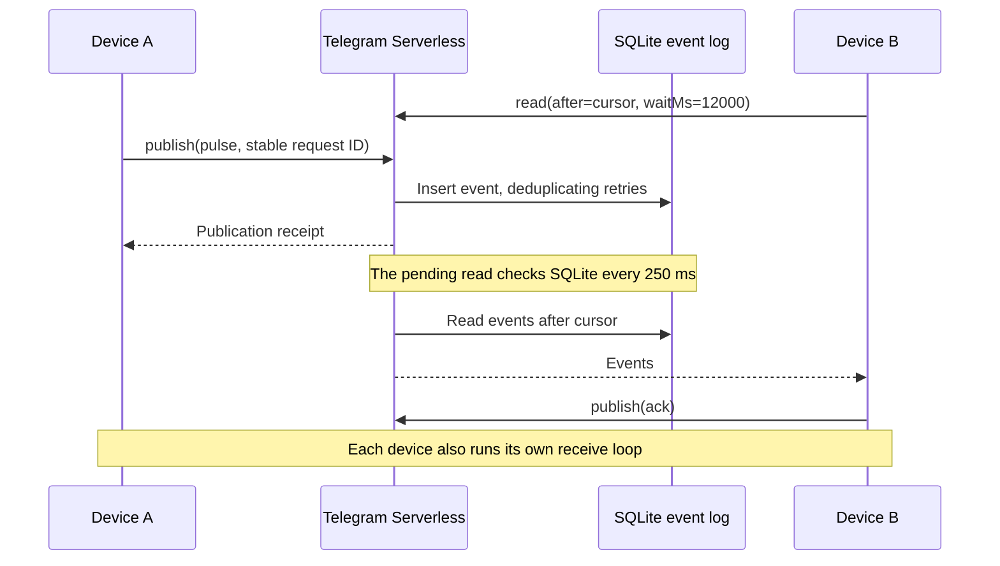

# Telegram Serverless Realtime

**Experimental near-realtime messaging using bounded long polling.**

A small two-device demo running on [Telegram Serverless](https://core.telegram.org/bots/serverless):
Mini App hosting, verified Telegram identity, temporary rooms, a durable SQLite
event log, replay and receipt acknowledgements. No separate application server
or external message relay.

**The backend polls its database every 250 ms while waiting.** An idle listener
performs roughly four event reads per second, plus request-boundary work. This
is a reference experiment, with no production scale or latency guarantee.

## How it works



- One pending read per client; sending can run alongside it.
- A 12-second wait budget, capped at 49 event queries per read.
- One immediate query in short-poll mode, then a 500 ms client delay when empty.
- Automatic short-poll fallback after two read failures.
- Stable publication IDs make retries idempotent.
- Ordered replay after a saved cursor; processing can repeat after a crash.
- Pause/resume and background handling. A request already sent may still finish.
- Same Telegram account on two devices, or an owner and one guest user.

The 250 ms interval is **not** an end-to-end latency promise. ACK measurements
use one sender-side clock and include both directions, queuing and processing.

## Run your own

Requires Node.js 24+, a Telegram bot with Serverless access, and Mini App setup
in [@BotFather](https://t.me/BotFather). Use a dedicated test bot.

```sh
git clone https://github.com/inlanger/telegram-serverless-realtime.git
cd telegram-serverless-realtime
npm ci
npm test
npm run tgcloud -- login
```

1. Set `BOT_USERNAME` in [`web/config.js`](web/config.js) to your bot's public
   username, without `@`. This file contains no secret.
2. Deploy the code and static files, then create the database tables:

   ```sh
   npm run deploy
   npm run tgcloud -- migrate
   ```

   `push` does not apply database migrations. Review and apply the two new tables
   with `migrate` before using the demo. No front-end build step is needed.
3. Set the **Main Mini App** URL in BotFather to the `https://app<id>.tgcloud.ai/`
   URL printed by the CLI. Open `https://t.me/YOUR_BOT_USERNAME?startapp=rt`.
4. Create a room, open its invite on a second device, and send a pulse.
5. Use **Delivery checks** to send ten pulses, test pause/replay, switch polling
   modes and download measurements.

The CLI access token belongs only in the CLI's local credential storage. The
browser uses the official `Telegram.WebApp.Serverless.call`; Telegram validates
the launch data and supplies `ctx.initData.user.id`. There is no extra user login.
If your environment requires an HTTP proxy, run the CLI with
`NODE_USE_ENV_PROXY=1` on supported Node versions.

## Tests and evidence

```sh
npm test
npx playwright-core install chromium
npm run test:browser
npx playwright-core install webkit
LAB_BROWSER=webkit npm run test:browser
```

For an existing Chromium installation, set `CHROME_PATH` when running the browser
test. Linux WebKit may need Playwright's system dependencies installed.

Service/client tests use real local SQLite. Browser tests run two clients with a
mock Telegram bridge backed by that service. They do **not** test genuine Telegram
signatures or physical Telegram clients. No credentials or cloud calls are needed.

The original lab also passed cloud checks through `/manage/run`: concurrent guest
claims, duplicate publications, membership checks, replay and a bounded empty wait.
These used synthetic context and are **not** signed Mini App `/api` measurements.
The extracted project has not been independently deployed as part of publication.

See [verification and historical evidence](docs/verification.md),
[protocol and limits](docs/protocol.md), and [research findings](docs/research.md).

## Bounds and trust

| Limit | Value |
| --- | --- |
| Active rooms per owner | 4 |
| Room lifetime | 1 hour |
| Users per room | Owner + one guest |
| Events per room | 2,000, including ACKs |
| JSON payload | 1,024 JavaScript string code units after serialization |
| Events in one read | 64 |

A random invite lets its holder claim the guest slot. Subsequent access requires
the stored owner/guest user ID. Device IDs are caller-supplied labels, not signed
identities; an ACK is a diagnostic receipt, not proof of an honest remote peer.

Expired data is removed on room creation, with no background cleanup. These bounds
are not rate limiting: an authenticated user can still issue concurrent requests.
Do not treat this as a hardened public relay or a proven large-audience service.

## Experimental combined exchange

[`experiments/combined-exchange`](experiments/combined-exchange) contains a tested
adapter for command + ACK + read in one request, plus ordered handling of overlapping
responses. It reduces round trips in the measured sequential scenario, **not SQL
work**. It is not wired into the demo or deployed by `tgcloud push`.

## Contributing

Useful reports include Telegram platform/version, network type, polling mode and
the demo's exported measurements. Never attach tokens, `initData`, private room
invites or CLI state. Physical iOS/Android results and measured ways to reduce idle
database reads are especially welcome.

Extracted from the realtime research for
[Terminal Tournament](https://github.com/inlanger/terminal-tournament).
Independent community experiment; not an official Telegram project. [MIT](LICENSE).
