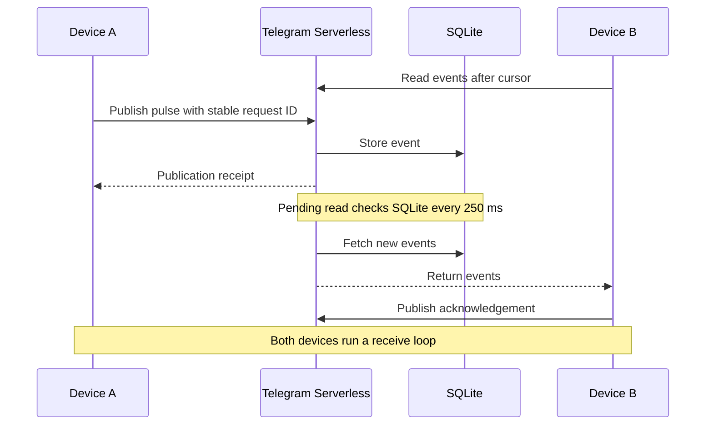

# Telegram Serverless Realtime — Long Polling for Telegram Mini Apps

A JavaScript example for adding near-realtime communication to **Telegram Mini Apps**
using [Telegram Serverless](https://core.telegram.org/bots/serverless).
Create a room, invite another device, and exchange events through Telegram's
built-in SQLite database. Telegram hosts the frontend and backend and verifies
the user's identity; you don't need a separate application server.

The demo includes event acknowledgements, reconnect replay, duplicate protection
and round-trip measurements. Use it as a starting point for exploring multiplayer
updates, shared rooms and other interactive Mini App features.

**Transport:** bounded HTTP long polling, with a database check every 250 ms while
waiting. This is an experimental implementation with published tests and
[measurement results](docs/verification.md).

## Try the demo on your own bot

You need **Node.js 24+**, a bot with Telegram Serverless enabled, and access to
its Mini App settings in [@BotFather](https://t.me/BotFather).

```sh
git clone https://github.com/inlanger/telegram-serverless-realtime.git
cd telegram-serverless-realtime
npm ci
npm run tgcloud -- login
```

Set your bot's public username in [`web/config.js`](web/config.js), without `@`:

```js
export const BOT_USERNAME = 'your_bot_username';
```

Deploy the JavaScript modules and frontend, then apply the database schema:

```sh
npm run deploy
npm run tgcloud -- migrate
```

The frontend is plain HTML, CSS and JavaScript, so there is no build step.
Deployment and database migration are separate operations; apply both before
opening the demo.

In BotFather, set the **Main Mini App** URL to the `https://app<id>.tgcloud.ai/`
address printed by the CLI. Then open:

```text
https://t.me/YOUR_BOT_USERNAME?startapp=rt
```

Create a room and open its invite on a second device. You can use the same
Telegram account on both devices, or invite one other user.

Press **Send pulse** to see delivery and acknowledgement. Open **Delivery checks**
to send a burst, pause and resume receiving, switch polling modes, or export
measurements.

## What is included

- **Telegram authentication:** the official Mini App SDK sends launch data;
  the platform verifies it before your endpoint runs.
- **Private invitation rooms:** a random invite admits one guest, with subsequent
  access checked against the room's owner and guest.
- **Durable event delivery:** SQLite stores events in sequence for replay after
  a connection interruption.
- **Safe publication retries:** stable request IDs prevent duplicate writes when
  a response is lost.
- **A two-device test interface:** receipt acknowledgements, round-trip timing,
  pause/resume and JSON result export.

The client keeps one read request open at a time and can send while listening.
After repeated read failures, it falls back to short polling. Receiving pauses
when the Mini App goes into the background.

## How long polling works on Telegram Serverless

The receiving device calls `realtime` with its last processed event sequence.
The endpoint checks for newer events and waits between checks, returning as soon
as it finds events or reaches its wait budget. The client processes the response
and starts the next read.



The backend uses a 12-second wait budget with at most 49 event queries per read.
Short-poll mode returns immediately and waits 500 ms between empty responses.
Query and network time contribute to the actual request duration.

This delivers near-realtime updates through ordinary JSON endpoints. It does
not require WebSocket or SSE support in Telegram Serverless.

See the [protocol reference](docs/protocol.md) for request fields, cursor handling,
retry behavior and the runtime-specific waiting implementation.

## Database cost and delivery guarantees

An idle long-poll listener performs roughly **four event reads per second**, plus
membership and request-boundary reads. Two listening devices therefore perform
roughly eight event reads per second. Long polling reduces repeated HTTP requests;
it does not remove database polling.

The 250 ms check interval is not an end-to-end latency guarantee. The demo measures
the full send → receive → ACK → sender cycle using one clock. Dividing that result
by two does not establish one-way latency.

Publication retries are idempotent. Event processing can repeat after a crash, so
application handlers must tolerate replay. An ACK records receipt by a client;
it does not prove that application side effects completed or that a peer is honest.

| Demo limit | Value |
| --- | --- |
| Active rooms per owner | 4 |
| Room lifetime | 1 hour |
| Users per room | Owner + one guest |
| Stored events per room | 2,000, including ACKs |
| Serialized JSON payload | 1,024 JavaScript string code units |
| Events per response | 64 |

Expired data is cleaned up when a room is created. A pending server request may
finish after the client pauses. Room bounds do not rate-limit incoming requests;
the demo has not established production-scale capacity.

## Run the tests

```sh
npm test

# Browser checks
npx playwright-core install chromium
npm run test:browser

# Optional WebKit checks
npx playwright-core install webkit
LAB_BROWSER=webkit npm run test:browser
```

The extracted project passed **22 service, client and experiment tests**, plus
seven browser scenarios in each of Chromium and Linux WebKit. Tests use real
local SQLite and a simulated Telegram bridge. No Telegram credentials are needed.

The original lab also passed cloud checks for concurrent joins, access control,
idempotency, replay and bounded waiting. Those checks used the management API
with synthetic user context. Physical Telegram client latency, signed Mini App
round trips and production capacity remain to be measured.

See [verification and raw evidence](docs/verification.md) for the exact scope.
For an existing Chromium installation, set `CHROME_PATH`. Linux WebKit may need
Playwright's system dependencies. Local browser output goes to `test-results/`.

## Explore the code

| Path | Purpose |
| --- | --- |
| [`tgcloud/endpoints/realtime.js`](tgcloud/endpoints/realtime.js) | Mini App endpoint and bounded waiting |
| [`tgcloud/lib/realtime.js`](tgcloud/lib/realtime.js) | Rooms, publications, access checks and reads |
| [`tgcloud/schema.js`](tgcloud/schema.js) | SQLite tables and indexes |
| [`web/realtime-client.js`](web/realtime-client.js) | Receive loop, ACKs, retries and cursor handling |
| [`web/`](web/) | Two-device demo interface |
| [`tests/`](tests/) | Service, client and browser checks |

A separate [combined-exchange experiment](experiments/combined-exchange) batches
command + ACK + read into one request. It reduced round trips in the measured
sequential scenario while performing the same SQL work. It is tested separately
and is not enabled in the demo.

The [research notes](docs/research.md) cover WebSocket, SSE, WebRTC and other
developers' approaches to realtime communication on Telegram Serverless.

## Contributing

Device reports are especially useful: include your Telegram platform/version,
network type, polling mode and the demo's exported measurements. Keep tokens,
`initData`, private room invites and CLI credentials out of reports.

The CLI access token stays in local CLI storage. Only the public bot username
belongs in `web/config.js`. If your environment requires an HTTP proxy, run the
CLI with `NODE_USE_ENV_PROXY=1` on supported Node versions.

This project grew out of realtime research for
[Terminal Tournament](https://github.com/inlanger/terminal-tournament).
It is an independent community project, available under the [MIT license](LICENSE).
