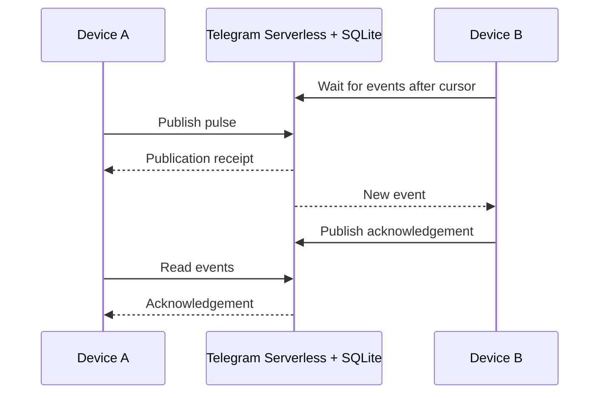

# Telegram Serverless Realtime — Long Polling for Telegram Mini Apps

A JavaScript demo for near-realtime communication between **Telegram Mini Apps**,
running entirely on [Telegram Serverless](https://core.telegram.org/bots/serverless).
Telegram hosts the frontend, backend and SQLite database, and handles user
authentication. No separate application server is needed.

Create a room, share an invite and exchange events between two devices.
The demo includes acknowledgements, reconnect replay, duplicate protection
and round-trip measurements.

## Features

- Invite another user or connect the same Telegram account on two devices.
- Receive events through long polling, with automatic short-poll fallback.
- Resume from the last processed event after a connection interruption.
- Retry publications safely using stable request IDs.
- Test delivery, pause receiving and export measurements from the Mini App.

## Quick start

Requires **Node.js 24+** and a bot with Serverless enabled in
[@BotFather](https://t.me/BotFather).

```sh
git clone https://github.com/inlanger/telegram-serverless-realtime.git
cd telegram-serverless-realtime
npm ci
npm run tgcloud -- login
```

Set your bot's public username in [`web/config.js`](web/config.js), without `@`:

```js
export const BOT_USERNAME = 'your_bot_username';
```

Deploy the app and create its database tables:

```sh
npm run deploy
npm run tgcloud -- migrate
```

In BotFather, set the **Main Mini App** URL to the `https://app<id>.tgcloud.ai/`
address printed by the CLI. Open `https://t.me/YOUR_BOT_USERNAME?startapp=rt`,
create a room and send its invite to the second device.

Press **Send pulse** to try it. **Delivery checks** lets you send a burst,
pause and resume receiving, change polling modes and download results.

## How it works

The client opens a read request with its last processed event sequence.
The backend checks SQLite for newer events every **250 ms**, returning when
events arrive or its **12-second wait budget** ends. The client processes the
batch, saves its cursor and opens the next request. Sending runs alongside receiving.



This uses HTTP long polling rather than WebSocket or SSE. An idle listener
performs roughly **four event reads per second**, plus access checks.
The demo measures the full send-and-acknowledgement round trip; 250 ms is the
database check interval, not a promised delivery time.

Rooms last one hour and hold up to 2,000 events, including acknowledgements.
See the [protocol reference](docs/protocol.md) for the API, limits and replay semantics.

## Tests

```sh
npm test
npx playwright-core install chromium
npm run test:browser
```

**22 tests pass**, with seven browser scenarios also checked in both Chromium
and Linux WebKit. Browser tests use real SQLite and a simulated Telegram bridge.
[Verification details and cloud measurements](docs/verification.md).

## Code and research

- [Backend](tgcloud/lib/realtime.js) — rooms, access checks and event storage.
- [Browser client](web/realtime-client.js) — polling, retries, ACKs and replay.
- [Combined exchange](experiments/combined-exchange) — a separate experiment that
  batches command + ACK + read to reduce HTTP round trips.
- [Research notes](docs/research.md) — Telegram Serverless transport options,
  WebRTC and findings from other projects.

Contributions and device measurements are welcome. Include your Telegram
platform, network type and exported results; leave credentials and launch data out.

Built during research for [Terminal Tournament](https://github.com/inlanger/terminal-tournament).
Community project · [MIT license](LICENSE).
